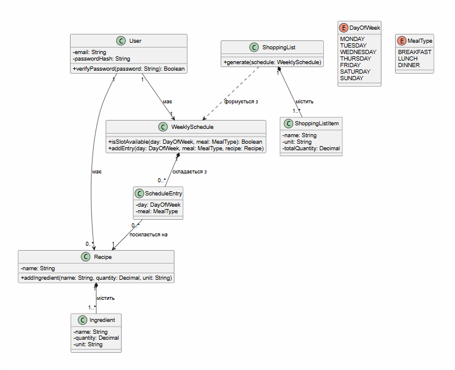

# Проєктування версії v1.0

## Діаграма варіантів використання

Діаграма ілюструє взаємодію Користувача із системою в межах версії v1.0 (реєстрація, вхід, створення рецептів, складання розкладу і генерація списку покупок). Вона охоплює всі функціональні вимоги FR-01…FR-12, їхню детальну відповідність наведено в матриці простежуваності.

## Деталізація сценаріїв (Activity Diagrams)

Покрокові специфікації наведено в [use-cases.md](use-cases.md). Перевірки та альтернативні завершення показано на діаграмах дій:

- UC-03 «Створити рецепт» (FR-05, FR-06): [model/activity-uc-03.md](../model/activity-uc-03.md);
- UC-05 «Скласти розклад меню на тиждень» (FR-08, FR-09): [model/activity-uc-05.md](../model/activity-uc-05.md);
- UC-07 «Згенерувати список покупок» (FR-11, FR-12, NFR-02): [model/activity-uc-07.md](../model/activity-uc-07.md).

## Діаграма класів

Діаграма класів фіксує предметну структуру, атрибути та зв'язки для v1.0. Пов'язана з вимогами FR-01…FR-12, а також з NFR-02 (точність кількості інгредієнтів) і NFR-04 (збереження хеша пароля).

**Відповідність термінів SRS і класів:**
| Термін SRS | Клас на діаграмі |
| :--- | :--- |
| Користувач | User |
| Рецепт | Recipe |
| Інгредієнт | Ingredient |
| Тижневий розклад | WeeklySchedule |
| Запис розкладу | ScheduleEntry |
| Список покупок | ShoppingList, ShoppingListItem |
| День тижня, прийом їжі | DayOfWeek, MealType |

## Основні проєктні рішення

- Рецепти особисті, унікальність назви перевіряється в межах користувача (FR-06).
- У користувача один тижневий розклад без прив'язки до дат.
- Список покупок обчислюється під час генерації й не зберігається.

## Життєвий цикл об'єктів (State Machine Diagram)

State Machine Diagram для версії v1.0 не будується. Об'єкти системи (рецепти, розклад, список покупок) не мають складного життєвого циклу чи змінних станів, оскільки функції редагування та видалення відкладені до наступних версій.