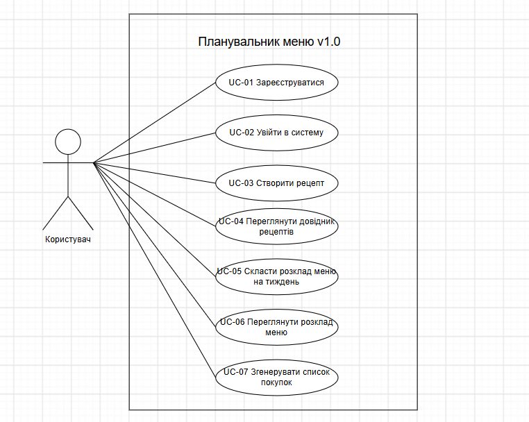

# Проєктування версії v1.0

## Діаграма варіантів використання

Діаграма ілюструє взаємодію Користувача із системою в межах версії v1.0. Згідно зі схемою, актор може зареєструватися та увійти в систему, створити рецепт, переглянути довідник рецептів, скласти розклад меню на тиждень, переглянути розклад і згенерувати список покупок.
