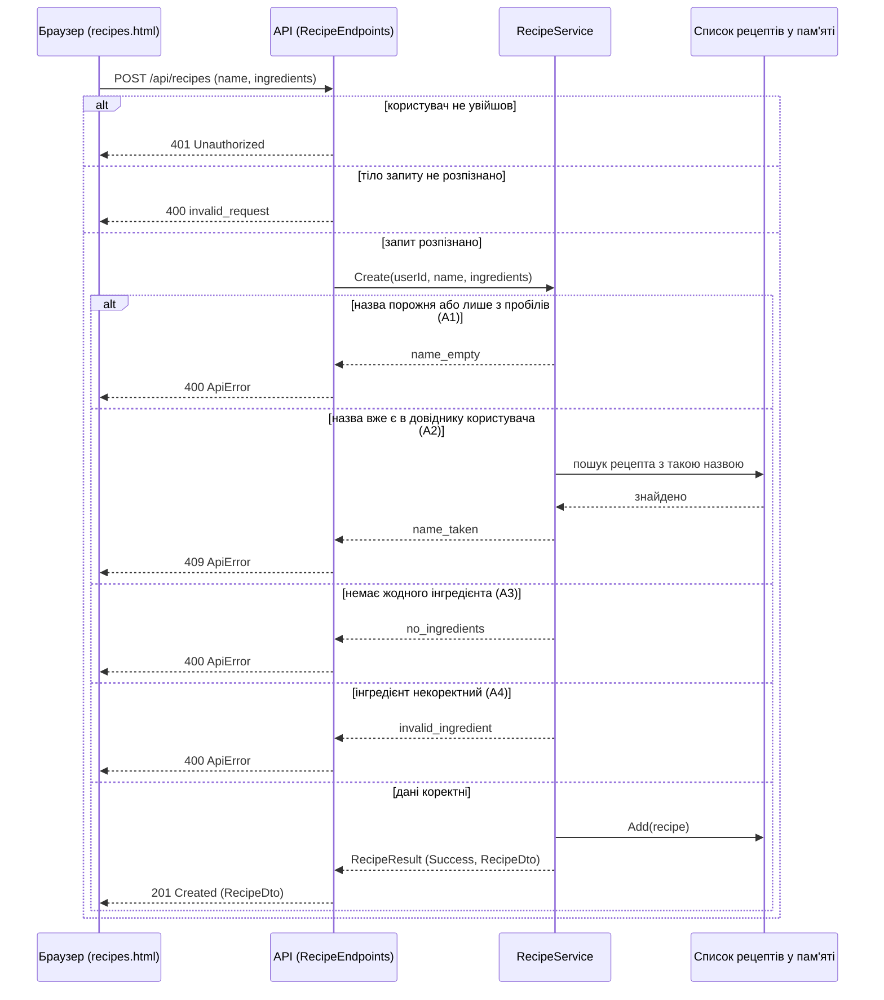

# Діаграма послідовності UC-03 «Створити рецепт» (Шевчук Ангеліна)

Діаграма побудована за фактичним кодом: сторінка `wwwroot/recipes.html`, маршрут
`POST /api/recipes` у `Endpoints/RecipeEndpoints.cs` та метод
`RecipeService.Create` у `Services/RecipeService.cs`.

У гілках A1–A4 виклику `Add` немає: список рецептів не змінюється. Запис додається лише
після успішних перевірок (останній варіант `alt`). Перевірка назви на унікальність і
додавання виконуються під спільним `lock`, тому два одночасні запити не створять
рецепти з однаковою назвою.

Перегляд довідника (UC-04) виконує окремий запит `GET /api/recipes`, який повертає
`RecipeService.GetAll(userId)`.
