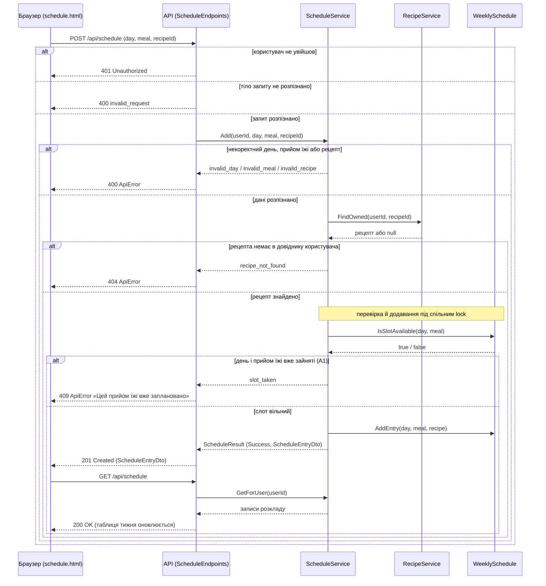

# Діаграма послідовності UC-05 «Скласти розклад меню на тиждень» (Миронюк Марія)

Діаграма побудована за фактичним кодом: сторінка `wwwroot/schedule.html`, маршрут
`POST /api/schedule` у `Endpoints/ScheduleEndpoints.cs`, метод `ScheduleService.Add`
у `Services/ScheduleService.cs`, пошук рецепта `RecipeService.FindOwned` та методи
`WeeklySchedule.IsSlotAvailable` і `WeeklySchedule.AddEntry` у `Models/WeeklySchedule.cs`.

У гілках відмови виклику `AddEntry` немає: розклад не змінюється (постумова UC-05
«Помилка: розклад не змінено»). Запис додається лише після всіх перевірок. Перевірка
`IsSlotAvailable` і `AddEntry` виконуються під спільним `lock`, тому два одночасні
запити не займуть один слот двічі.

Відповідність кроків UC-05: кроки 1–5 — дії на сторінці `schedule.html` і запит
`POST /api/schedule`; крок 6 — `IsSlotAvailable`; крок 7 — `AddEntry`; крок 8 —
відповідь `201 Created`; альтернатива A1 — гілка `slot_taken` із відповіддю `409`.

Перегляд розкладу (FR-10) виконує окремий запит `GET /api/schedule`, який повертає
`ScheduleService.GetForUser(userId)`.
