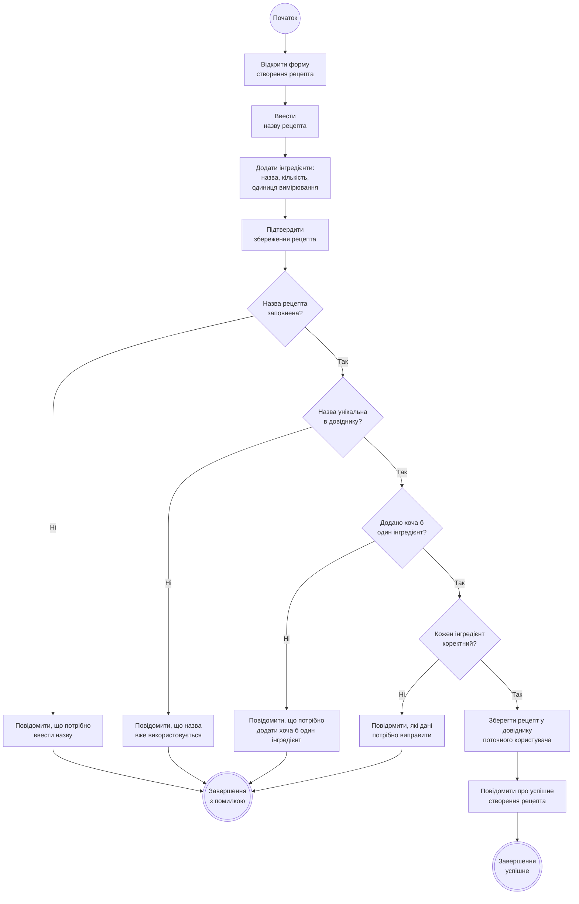

# Activity Diagram UC-03 «Створити рецепт»

Діаграма показує послідовність дій під час створення нового рецепта: від відкриття форми до підтвердження збереження, після чого система виконує чотири послідовні перевірки: чи заповнена назва, чи унікальна вона в довіднику Користувача, чи додано хоча б один інгредієнт та чи коректні дані кожного інгредієнта. Залежно від результату сценарій завершується успішним збереженням рецепта (FR-05) або відхиленням збереження з повідомленням про причину (FR-06).

