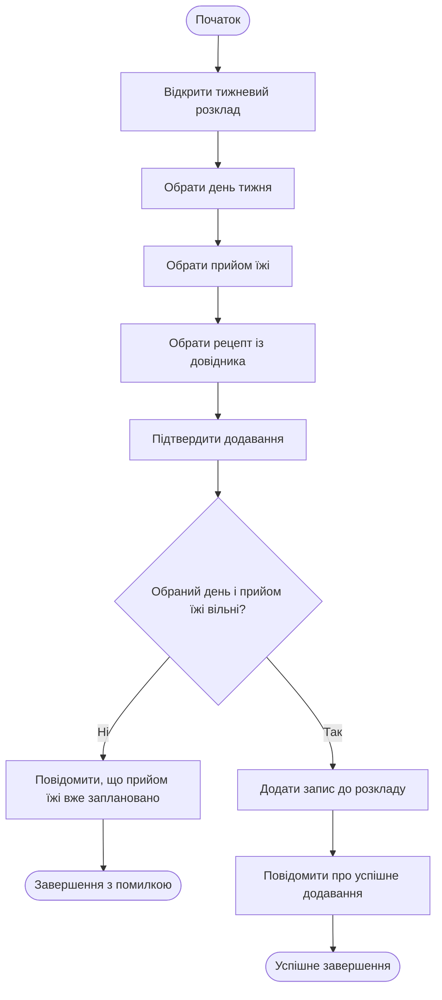

# Activity Diagram UC-05 «Скласти розклад меню на тиждень»

Діаграма показує послідовність дій під час додавання страви до тижневого розкладу та єдину точку перевірки: чи вільний обраний день і прийом їжі. Залежно від результату сценарій завершується успішно (FR-08) або відхиленням запису (FR-09).

| Крок специфікації UC-05 | Елемент Activity Diagram |
| :--- | :--- |
| 1–5. Відкриття розкладу, вибір дня, прийому їжі та рецепта, підтвердження | Послідовні дії на початку діаграми. |
| 6. Перевірка, що день і прийом їжі вільні | Вузол рішення «Обраний день і прийом їжі вільні?»; гілка «Ні» веде до A1. |
| 7–8. Додавання запису та підтвердження | Успішна гілка після проходження перевірки. |