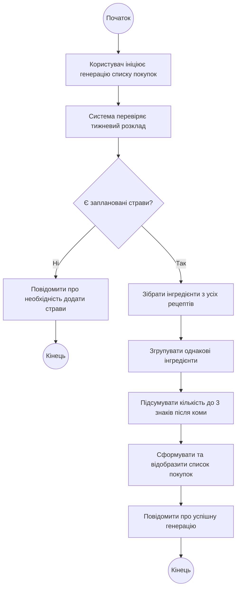

# Activity Diagram UC-07 «Згенерувати список покупок»

Діаграма показує послідовність дій під час генерації списку покупок на основі тижневого розкладу та перевірку наявності запланованих страв. Залежно від результату перевірки сценарій завершується або відхиленням з виведенням повідомлення (FR-12), або успішною генерацією зведеного списку (FR-11, NFR-02).

